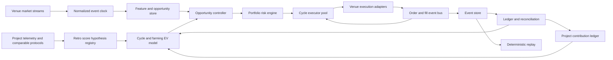

# Entropy 回溯积分耕作系统性重构蓝图

## 目标与边界

系统的最终目标是在合规、仓位和亏损预算内，最大化 **Entropy 未来回溯评分中的稳健权重**。交易闭环是创造真实、可归因项目价值的手段，不是最终目标。

```text
robust_farming_objective
  = min over plausible retrospective scoring models (
      marginal_project_contribution_score
      × scenario_shadow_value
    )
  + realized_trading_pnl
  + confirmed_cash_offsets
  - tail_risk_reserve
```

系统维护三本互不混算的账：

- **项目贡献账**：成交量、费用贡献、流动性、持仓资本时间、活跃 epoch、价格发现质量和留存。
- **回溯评分情景账**：每种可能的未来权重公式独立计分，不伪造一个看似精确的总分。
- **现金与风险账**：权威成交损益、手续费、资金费、返现、未对冲时间和尾部损失。

截至 2026-09-10，Entropy 没有公布 points、token、airdrop、season 或回溯公式。任何现有现金活动都不用于推断未来积分权重；回溯策略按未获得现金补贴的保守成本设计。

开仓数、成交额和单腿成交数是成本与资格指标。一个严格闭环必须具有同一个 `cycle_id` 下的：

```text
OPEN first fill
→ OPEN hedge fill
→ REDUCE first fill
→ REDUCE hedge fill
→ venue reconciliation confirms FLAT
```

当前策略持仓等待基差回归，因此属于跨场所基差均值回归。它承担退出前的基差风险，不能按即时无风险套利建模。任何耕作活动都必须来自真实市场风险转移；不使用自成交、关联账户互刷、虚假推荐或规避限频来制造活动。

## 当前实盘结论

50 个严格闭环证明了执行链能够高频归零，但没有证明 alpha：

- 总净收益 `-$0.218651`，单循环均值约 `-2.93 bps`。
- 50 个循环中只有 4 个盈利。
- 手续费约 `1.8 bps/循环`，四个已归因成交阶段平均约 `1.65 bps/循环`。
- OPEN 第一腿的 REST 确认平均约 `1.02s`，其间第二腿盘口会继续移动。
- 原 8–20 秒快速退出频繁把暂时浮亏兑现为永久亏损。
- Entropy 端只有 SNDK；降低门槛能增加循环数，但会增加负期望样本。

这 50 个闭环在 Entropy 端产生约 `$1,490.10` 的双边成交量和 `$0.134047` 的实际手续费：

```text
observed trading pnl                         -$0.218648

cash acquisition cost per $1,000 raw Entropy volume
  = $0.218648 / $1,490.10 × $1,000
  = $0.1467
```

该 `$0.1467 / $1,000` 是当前执行方式在不依赖任何现有激励时的保守现金成本基线，不代表未来积分价值。

这也给出了不依赖空投传言的情景边界。假设奖励最终按合格成交量线性分配，覆盖当前成本所需的“获奖时价值”为：

| 获奖概率假设 | 每 `$1,000` 合格成交量至少需要的获奖时价值 |
|---:|---:|
| 100% | `$0.1467` |
| 50% | `$0.2935` |
| 20% | `$0.7337` |
| 10% | `$1.4673` |

这张表只是预算反推，不是对 Entropy 奖励的预测；实际分配可能与成交量无关。

这意味着系统不应为了一个尚未公布的空投公式无限买量。频率只能来自更快的成交流、更短的资金占用、较低的边际获取成本，以及 SNDK 在实际支持场所之间的最优路由。若没有通过现金收益门槛的机会，系统只可在独立、有限的探索预算内创造难以伪造的项目贡献。

## 从项目方反推可能的回溯权重

项目方不会长期奖励“最容易刷”的动作，而会奖励能改善核心业务、可持续且抗女巫的行为。Entropy 的产品定位是 frontier / equity perpetual markets，因此最可能重视：

| 推测维度 | 对项目方的价值 | 回溯可观测性 | 推测置信度 |
|---|---|---|---:|
| Entropy 原生市场的费用贡献 | 协议与 deployer 收入，最难伪造 | 每笔 fill 的 fee | 高 |
| 跨日、跨周活跃 | 留存和真实用户证明 | wallet × UTC day/week | 高 |
| time-weighted OI / margin-hours | 持续市场深度和资本承诺 | 持仓快照、资金费 | 高 |
| 有效 maker 流动性 | 更紧 spread、更深盘口、更好成交 | 挂单时间、距中价、成交量 | 中高 |
| 原生市场成交量 | 活跃度与价格发现 | raw 与加权 volume | 中高 |
| 盈亏与 ROI 分布 | 区分真实风险承担和机械对刷 | 已实现 PnL、ROI | 中 |
| 严格闭环数 | 展示重复使用，但业务价值弱于量和资本时间 | cycle ledger | 低中 |
| 极短、同尺寸、密集往返 | 容易生成，缺少持续流动性价值 | 高频模式检测 | 负权重风险高 |

这些是推断，不是 Entropy 已宣布规则。推断依据包括：Entropy 自己的 leaderboard 已预留 volume、realized PnL、ROI 和 OI 字段；同类永续协议公开积分设计通常把费用贡献、maker 流动性、持仓大小与持续时间、PnL 和活跃周期组合计分，并对 wash trading 或机械对冲做折扣。

还要同时保存两种成交量。Entropy 官方费用文档说明，HIP-3 市场开启 growth mode 时，手续费、rebate 和 `volume contribution` 均乘以 `0.1`。本项目实盘约 `0.9 bps` 的 Entropy taker fee 与此一致。因此：

```text
raw_entropy_volume
growth_adjusted_volume
entropy_fee_contribution
time_weighted_open_interest
```

必须分别记录。若未来按协议加权量或费用贡献回溯，当前 `$1,490` raw volume 可能只有约 `$149` 的 volume contribution；若按 Entropy 自己的原生市场活动回溯，项目方也可能采用 raw volume。系统不能提前把两者合并。

## 目标架构



### 0. 回溯评分假设必须并行版本化

新增 `RetroScoreHypothesisRegistry`。它不输出一个伪精确的“预计积分”，而是保存彼此独立的可能评分模型：

```python
RetroScoreHypothesis(
    hypothesis_id,
    evidence,
    feature_transforms,
    epoch_definition,
    diminishing_return_curve,
    sybil_penalties,
    confidence,
    version,
)
```

至少并行评估五个情景：

- `FEE_WEIGHTED`：按 Entropy 实际费用贡献计分。
- `VOLUME_WEIGHTED`：按 growth-adjusted volume，采用平方根或 `log1p` 边际递减。
- `RETENTION_WEIGHTED`：按 active days/weeks 和跨时段参与计分。
- `OI_WEIGHTED`：按 `notional × holding_time` 与资金费事件计分。
- `LIQUIDITY_QUALITY`：按 maker 挂单的有效时间、深度、spread 和真实成交计分。

每次候选交易计算一个 score vector。只有当它能补充当前覆盖不足的维度，或者交易本身现金 EV 为正时才有高优先级。未来一旦出现官方规则，就冻结此前的 hypothesis version，并从官方规定的快照范围重算。

### 1. 统一事件层

每条行情、订单命令、ACK、订单状态、成交、仓位快照和资金事件都使用统一信封：

```python
Event(
    event_id,
    run_id,
    cycle_id,
    causation_id,
    venue,
    instrument,
    event_type,
    venue_ts,
    receive_ts,
    sequence,
    payload,
)
```

要求：

- 交易所时间、接收时间和本地处理时间分开保存。
- 行情流检测序号缺口；缺口期间禁止 OPEN。
- 成交用交易所 `trade_id` 去重，订单用稳定 `client_order_id` 关联。
- 所有状态改变先形成事件，再更新内存投影；SQLite/Postgres 是可重放事实源。
- REST 返回、WebSocket 回报和定期 reconciliation 是三种证据，不能互相冒充。

### 2. Venue adapter 只负责交易所语义

`HyperliquidAdapter`、`LighterAdapter` 统一输出：

- 标准化 L2 增量与快照；
- `submit/cancel/query` 命令结果；
- `Accepted/PartialFill/Filled/Canceled/Rejected/Unknown` 订单事件；
- 账户、保证金、仓位和资金费快照；
- 交易所精度、最小订单和速率限制。

adapter 不计算策略门槛、预期收益或退出条件。未知结果不得自动换新 ID 重下；必须先查询原 ID 或通过成交流恢复。

### 3. 每个机会生成一个有限生命周期 CycleExecutor

把目前集中在 `engine.py` 的全局流程拆成独立执行器：

```text
CREATED
→ PREFLIGHT
→ OPEN_SUBMITTING
→ OPEN_PARTIAL | HEDGED
→ HOLDING
→ REDUCE_SUBMITTING
→ REDUCE_PARTIAL | FLAT_PENDING_RECONCILIATION
→ COMPLETED

任意阶段 → RECOVERING → COMPLETED | FAILED_UNSAFE
```

每个状态都有进入条件、超时、允许命令、退出条件和持久化事件。`COMPLETED` 只有在两边仓位经交易所核对为零后成立。

执行器拥有自己的：

- 四腿订单与所有部分成交；
- 成交成本、手续费、资金费和持仓时间；
- 退出目标、止损、超时与恢复预算；
- 严格闭环结果。

Controller 只能创建或停止执行器，不能直接操作订单。这个结构对应成熟框架中的 Controller/Executor 分工。

### 4. 两腿执行改成策略化协调器

为 OPEN 和 REDUCE 分别支持三种执行策略，并用实盘条件选择：

1. **Concurrent IOC**：两边预检查通过后同时提交。适合两边成交流可靠、填单概率高的机会，能显著减少跨腿漂移。
2. **Sequential IOC**：先执行较难成交或风险更高的一腿，收到权威成交后立即对冲。适合一边回报不可靠的场所。
3. **Maker then hedge**：一边被动成交后立刻在另一边吃单。只有 maker 成交后的条件期望扣除 adverse selection 仍为正时启用。

当前项目应先落地 Concurrent IOC 与 Sequential IOC 的动态选择。预估公式必须同时比较：

```text
expected_execution_loss
  = fill_probability_weighted_slippage
  + expected_cross_leg_move
  + partial_fill_recovery_cost
  + timeout_tail_cost
```

Concurrent IOC 不能简单 `gather()` 后假定两边都成交。每条腿独立消费权威成交事件；任何净 delta 超过容忍值时，恢复执行器获得最高下单优先级。

### 5. 入场模型直接预测完整循环结果

不再用“当前价差大于固定门槛”近似盈利。每个候选机会保存特征：

- 统一偏离、双边盘口深度、spread、短期波动与 order-flow imbalance；
- 两边行情年龄和时间偏差；
- 各腿历史填单概率、延迟分布和条件滑点；
- 方向、时段、资金费、持仓拥挤度；
- 中枢状态、回归速度、同类机会的删失时间。

模型输出完整生命周期分布：

```text
P(target hit before horizon | x)
P(forced exit | x)
E[exit pnl | target hit, x]
E[forced-exit pnl | x]
E[holding seconds | x]
CVaR95[pnl | x]
```

每个候选同时计算现金结果与项目贡献向量：

```text
trading_ev
  = p_hit × target_outcome
  + p_forced × forced_exit_outcome
  - open_cost
  - close_cost
  - funding_cost
  - capital_cost
  - model_uncertainty

cash_ev_after_offsets
  = trading_ev
  + eligible_entropy_fee × verified_cashback_rate
  + other_formula_verified_reward

project_contribution_vector = [
  marginal_fee_contribution,
  marginal_growth_adjusted_volume,
  marginal_active_epoch,
  marginal_oi_hours,
  marginal_maker_quality,
  organic_activity_quality,
]

scenario_scores
  = each retro hypothesis(project_contribution_vector)

robust_score_gain
  = lower quantile(scenario_scores after sybil penalties)

admit when:
  cash_ev_after_offsets confidence bound > production floor
  and CVaR / margin / liquidity constraints pass

or, in explicitly budgeted exploration mode:
  robust_score_gain > 0
  and marginal_acquisition_cost_per_$1k <= exploration cap
  and daily/campaign loss budgets remain
  and the trade is otherwise genuine and eligible
```

不能把回溯积分假设混入“已证明盈利”。它只决定探索预算内先覆盖哪个项目贡献维度。若未来官方公布积分或空投公式，再从适用快照起点重算。

未成交和被拒绝的候选也要保存未来路径，否则模型只看到被选中的交易，会产生选择偏差。超时未回归属于删失样本，不能当作零秒成功样本。

第一版不需要复杂神经网络。按方向、偏离区间、波动和流动性分桶的 Beta-Binomial 命中率，加上稳健均值/分位数退出损益，就足以比确定性“必然回归”模型正确。

### 6. SNDK 单标的机会池

当前执行器只处理 Entropy 的 SNDK。Controller 只对已经验证支持 SNDK、具备稳定 API 和真实深度的 hedge venue 建立路径。现金正期望与积分探索分别排序：

```text
alpha_score = cash_ev_after_offsets_usd / expected_capital_seconds

exploration_score
  = robust_score_gain
  / max(expected_acquisition_cost_usd, minimum_cost_unit)
```

不同 hedge venue 的候选共享同一个 Entropy SNDK 风险源，不能当作独立 alpha。CycleExecutor pool 只有在虚拟 lot、成交分配和组合净额全部可靠后才允许有限并发，并受以下约束：

- SNDK 最大并发 cycle；
- 每交易所总名义敞口；
- 所有路径聚合后的 SNDK delta；
- 保证金、速率限制和恢复订单预留；
- 单 cycle、单小时、单日和单策略版本亏损预算；
- 每千美元合格 Entropy 成交量的边际获取成本；
- 同一市场状态或同一信号 episode 的最大重复次数；
- 官方 rate limit 与条款允许的合理自动化频率。

多个 SNDK cycle 使用虚拟 lot 独立记账；交易所层可以净额下单，但 allocation engine 必须确定性地把成交分配回 cycle。未建立这层前，不应把 `max_active_pairs` 从 1 直接调大。若所有已验证 hedge 路径都没有通过经济门槛，正确行为是零交易或仅使用明确受限的探索预算。

### 7. 风控与策略分离

RiskEngine 是所有 OPEN/ADD 命令的同步前置关卡，并异步监听账户事件。至少实现：

- `ACTIVE / REDUCING_ONLY / HALTED` 全局交易状态；
- 每单名义、每 cycle 风险、组合 delta、保证金和速率限制；
- 行情陈旧、序号缺失、订单流断开时禁止新增风险；
- 权威成交流不可用时禁止 OPEN，REDUCE 和 recovery 保留；
- 累计净亏损、连续异常、未知订单和 reconciliation 差异熔断；
- 风险退出永远不受利润门槛阻挡。

退出采用 take-profit、time limit、loss limit 和 regime invalidation 四个相互独立的 barrier。时间上限必须真的触发退出，不能只是状态标签。

### 8. 账本以闭环为中心

建议核心表：

```text
runs
events
orders
fills
cycles
cycle_legs
position_snapshots
candidate_opportunities
cost_model_versions
policy_versions
reconciliation_reports
incentive_policy_versions
incentive_attributions
incentive_activities
incentive_claims
retro_score_hypotheses
project_contribution_epochs
```

`cycles` 的净收益只从权威 fills、实际费用、资金费和恢复成本聚合。账户权益变化用于 reconciliation，不能直接替代策略闭环收益。每个报表必须显示不可解释差额：

```text
account_equity_change
- attributed_cycle_pnl
- deposits_withdrawals
- non_strategy_funding_and_fees
= unexplained_pnl
```

激励账本保留从预计到到账的完整状态迁移：

```text
estimated → held → approved → claimed → paid
```

每条 incentive activity 关联 Entropy 的权威 fill ID、program version 与账户 attribution。无法关联的返现不能摊回 cycle。核心报表同时给出：

```text
raw_entropy_volume_usd
growth_adjusted_volume_usd
entropy_fee_contribution_usd
maker_volume_usd
maker_quote_time_near_mid_sec
oi_usd_hours
active_utc_days / active_utc_weeks
activity_concentration / repeated-pattern score
raw_fees_usd
estimated_cashback_usd
approved_cashback_usd
paid_cashback_usd
cash_pnl_after_offsets_usd
acquisition_cost_usd_per_$1k_volume
strict_cycles
score under each retrospective hypothesis
```

leaderboard 的成交量、已实现 PnL、ROI 和 OI 是公开表现指标，不等同于激励分配公式。

### 9. 研究、回放和实盘使用同一状态机

回放不重写一份简化策略。它向相同的 Controller、RiskEngine 和 CycleExecutor 注入模拟的行情和成交事件。

FillSimulator 从实盘分布采样：

- 提交、ACK、首笔成交和终态延迟；
- 条件填单概率和部分成交比例；
- 订单尺寸对应的盘口冲击；
- WebSocket 丢包、REST 超时、晚到成交和速率限制；
- funding 与保证金变化。

验证采用按时间 walk-forward 的 train/validation/test，参数只在训练段选择。最终测试段只运行一次。相邻信号高度相关时，置信区间要按 episode 或交易日聚类，不能把每秒样本当作独立样本。

激励回放使用当时生效的 policy version。不得用后来公布的规则倒推旧成交一定符合资格；不确定资格以 0、基准和乐观三个情景分别展示。

### 10. 版本化发布

每个 cycle 固定以下版本，运行中不得漂移：

```text
strategy_version
feature_schema_version
model_version
cost_model_version
execution_policy_version
risk_policy_version
config_hash
incentive_policy_version
```

新版本按以下顺序升级：

```text
offline replay
→ shadow（只生成决策）
→ canary（小名义 + 小亏损预算）
→ champion/challenger
→ 增加通过验收的 SNDK 对冲路径或资金
```

## 代码迁移方案

避免一次性重写。保留已验证的 adapter 和账实核对路径，用 strangler 方式逐步替换 `engine.py`：

```text
entropy_arb/domain/
  events.py
  orders.py
  cycles.py

entropy_arb/adapters/
  hyperliquid.py
  lighter.py

entropy_arb/execution/
  oms.py
  cycle_executor.py
  leg_coordinator.py
  recovery.py

entropy_arb/strategy/
  opportunity.py
  controller.py
  ev_model.py

entropy_arb/risk/
  engine.py
  limits.py

entropy_arb/storage/
  event_store.py
  projections.py
  reconciliation.py

entropy_arb/simulation/
  clock.py
  fill_model.py
  runner.py
```

迁移顺序：

1. **事件与不变量**：先定义事件信封、订单状态机、cycle 状态机和严格完成条件；现有引擎以适配层写入新事件。
2. **OMS 与 reconciliation**：把订单身份、去重、未知结果和恢复从策略扫描中抽出。
3. **CycleExecutor**：用新执行器接管单一 SNDK、小名义 canary；旧引擎只做 controller。
4. **同源回放**：让回放驱动同一个执行器；校准实际延迟与填单分布。
5. **EV Controller**：替换确定性回归预算，保存所有候选的反事实路径。
6. **SNDK 路由池**：加入经验证支持 SNDK 的 hedge venue，再逐步提高 executor 并发；不通过降低门槛强推频率。
7. **删除旧路径**：新旧影子决策与账本一致后，移除 `engine.py` 中已迁出的逻辑。

## 运行策略

系统同时维护三个互斥运行状态，由 controller 在每次 OPEN 前判定：

1. **`ALPHA_FARM`**：扣除执行成本与可确认现金抵扣后，完整循环的保守 EV 为正。该状态可以持续运行，但仍受日亏损和尾部风险限制。
2. **`RETRO_CANARY`**：现金 EV 不为正，但候选能补充当前缺少的项目贡献维度。只选择 `robust_score_gain / acquisition_cost` 最高的候选，累计现金亏损不得超过 `$3`，并按 signal episode 限制重复交易。
3. **`REDUCING_ONLY`**：边际项目贡献已饱和、成本越界、数据不可归因或风险状态异常。停止 OPEN，完成在途 REDUCE 和 reconciliation。

在当前没有官方空投公式的阶段，系统优化的是**给定探索预算下的低成本、真实资格覆盖**：

```text
minimize:
  expected acquisition cost + tail risk

subject to:
  strict OPEN → hedge → REDUCE → FLAT
  confirmed campaign loss <= $3
  venue/rate/risk limits pass
  activity is attributable and creates measurable project contribution
```

不设置“必须刷满多少成交量”的目标。已有 50 个闭环高度集中在 33 分钟、持仓约 10 秒，主要覆盖了 taker fee 与 raw volume，几乎没有覆盖跨日留存、OI-hours 或 maker 质量。继续重复同一模式的边际回溯价值很低。

在未来规则未知时，`$3` 探索预算按行为组合分配。这是对模型不确定性的组合对冲，并非猜测官方权重：

| 预算份额 | 行为目标 | 实盘约束 |
|---:|---|---|
| 40% | 跨日、跨周的真实活跃 | 每个新 UTC day 的首个合格 episode 价值最高；日内重复边际递减 |
| 30% | time-weighted OI / 资本时间 | 只在 basis 风险受控时延长持仓；不为跨快照而机械开平 |
| 20% | Entropy maker 流动性 | 只统计接近中价、真实驻留并成交的挂单；先小额 canary 测 adverse selection |
| 10% | 高质量 taker 成交与价格发现 | 只在异常偏离或流动性事件执行，避免同尺寸连续往返 |

调度器对每个 UTC day、week、signal episode、持仓时长桶和 maker 质量桶应用 `sqrt` 或 `log1p` 边际递减。同一小时内第 50 个相似闭环的探索优先级应远低于新一日的第一个真实闭环。

## 上线验收标准

执行正确性：

- 严格闭环完成率（已完成 OPEN 对）`>= 99%`。
- recovery/emergency 比例 `< 1%`，且没有未解释净 delta。
- 权威成交与账本数量、价格和手续费核对率 `>= 99.9%`。
- `p99` 未对冲时间必须由前向数据证明，并作为每个 venue pair 的硬门槛。

经济正确性：

- 至少 100 个同版本、严格闭环的前向样本；同时覆盖多个交易日和波动状态。
- 扣除实际费用、滑点、资金费、恢复和退出成本后，单循环净收益均值为正。
- 按 episode/交易日聚类后的单侧 95% 置信下界大于 0。
- `CVaR95`、最大持仓时间和资金占用在预算内。
- 报告同时给出 `net pnl/cycle`、`net pnl/hour` 与 `net pnl/capital-hour`。

耕作正确性：

- raw volume、growth-adjusted volume、fee contribution、OI-hours、active epochs 与 maker quality 可从权威事件复算。
- 每个回溯 hypothesis 独立展示得分和边际递减，任何 aggregate 都同时显示最差情景。
- 主指标为 `robust_score_gain / acquisition_cost`；不使用裸成交量或闭环数替代项目贡献。
- 未公布奖励默认按 0 美元入账；每个非零 shadow-value 情景都显示假设、盈亏平衡价值和最坏损失。
- 达到单日、单 campaign 或累计 `$3` acquisition-cost 预算后自动停止 OPEN，先完成在途闭环并核对至 FLAT。
- 重复模式、同尺寸极短往返和单一小时集中度必须显式进入反刷折扣，而不是只在报告里提示。

扩容规则：

- 先增加通过相同验收的 SNDK hedge 路径，再增加并发；所有路径仍按同一个 SNDK 聚合风险。
- 任一策略版本置信下界跌破 0，自动回到 shadow 或 `REDUCING_ONLY`。
- 参数更新产生新版本；旧样本只用于先验，不能与新版本简单混算后宣称显著。

## 当前最优先的三项工程

1. 建立 project-contribution ledger 和五套回溯评分 hypothesis，先把已有 50 个闭环按 raw/growth-adjusted volume、fee、OI-hours、active epoch 与模式集中度重算。
2. 把两腿执行抽成 `LegCoordinator`，加入 Entropy maker canary 与 Concurrent/Sequential IOC 对照，分别测量 liquidity quality、adverse selection 和现金获取成本。
3. 建立跨 UTC day/week 的边际递减调度器；`RETRO_CANARY` 只补充覆盖缺口，`ALPHA_FARM` 继续捕捉现金正期望机会。

完成这三项之后，再扩展通过验收的 SNDK hedge venue 路由池。扩量条件是边际获取成本下降或已确认激励价值上升，不能只因为预期空投。

## 参考设计

- Entropy 官方费用说明列出 HIP-3 maker/taker 费率，并说明 growth mode 下费用、rebate 与 volume contribution 同时乘以 0.1：<https://docs.entropy.io/equity-perp-mechanics/fees>
- Entropy 官方市场页体现项目对 frontier / equity perpetual markets 的定位：<https://entropy.io/>
- Entropy 当前 leaderboard 暴露 volume、realized PnL、ROI 与 OI 指标；这些证明数据可观测，不代表官方已承诺用于积分：<https://entropy.io/leaderboard>
- Aster 的官方积分规则是同类协议的参考样本：它组合费用贡献、maker 流动性、持仓大小与时长、PnL，并明确折扣 wash trading；这里只用于构造情景，不外推为 Entropy 规则：<https://docs.asterdex.com/stage-3-dawn/faqs>

- Entropy 官方条款规定自动化不得超过合理阈值、绕过限频或干扰系统：<https://entropy.io/terms>
- Hummingbot Strategy V2 将一次交易工作流建模为有限生命周期 Executor，由 Controller 创建和管理：<https://hummingbot.org/strategies/v2-strategies/>
- Hummingbot ArbitrageExecutor 在两边同时提交订单，并按净盈利条件触发：<https://github.com/hummingbot/hummingbot/blob/master/hummingbot/strategy_v2/executors/arbitrage_executor/arbitrage_executor.py>
- NautilusTrader 将 Strategy、RiskEngine、ExecutionEngine、ExecutionClient 与 Portfolio 分离：<https://nautilustrader.io/docs/latest/concepts/architecture/>
- NautilusTrader 的事件存储把命令、原始回报、事件与 reconciliation 作为可重放事实：<https://nautilustrader.io/docs/latest/concepts/event_sourcing/>
- NautilusTrader 的执行策略明确区分本地失败、交易所确定结果和未知结果，并对 fill 去重与过量成交做状态检查：<https://nautilustrader.io/docs/latest/concepts/execution/>
- Hyperliquid 官方 WebSocket 提供 `orderUpdates` 和 `userFills`，可用于降低依赖 REST 回包造成的跨腿等待：<https://hyperliquid.gitbook.io/hyperliquid-docs/for-developers/api/websocket/subscriptions>

## 当前落地状态（2026-09-10）

- `entropy_arb/retro_farming.py` 和 `tools/retro_score.py` 已能从 SQLite 只读复算三本账，并把五套 hypothesis 与原始贡献分开输出。
- canary 调度默认 `shadow`；即使通过 $3 总预算、分桶预算、单次预期损失、单位 growth-adjusted volume 成本、每小时间隔以及“每日一次或新贡献桶”检查，`should_execute` 仍为 `false`。
- 影子状态每 60 秒在线程中更新并进入 dashboard/API snapshot，不占用策略事件循环。
- 当前 50 个完整周期使下一候选成为从未覆盖的 `LIQUIDITY` 桶，执行路径要求 `maker-hedge`。该路径只读 preflight 已通过，Entropy maker 成本已按当前 growth mode 的 `0.3 bps` 纳入配置。
- 独立 `entropy-maker-hedge` 路径已把 `$3` canary 约束持久化：发布示例默认 `shadow`；本机在 2026-09-10 22:32 按操作者指令切换为 `active`。每轮先预留最大预期损失，关闭后按实际亏损结算，并限制总预算、20% liquidity 分桶、单次 `$0.03`、每 UTC day 一次和一小时间隔；进程重启不能重置预算。
- 同一路径已加入独立质量事实账本：逐挂单累计距 Entropy mid `<= 5 bps` 的实际驻留时间，逐 maker fill 保存数量与名义金额，采样 5 秒/30 秒 maker-side markout，并记录 Lighter hedge 确认延迟与相对请求 mid 的 taker 成本。开放挂单至多每 30 秒 checkpoint，成交与到期样本按事件写入，普通策略循环不查询 SQLite。
- 切换前再次执行只读 live preflight：两边仓位与 open orders 均为 0，行情、账户、资金费和质量账本检查通过。当前 active canary 的目标是以单轮 `$0.03` 最大预期亏损获取首个真实 adverse-selection 样本；在样本完成前不能把“已具备采集能力”误写成“maker 质量已通过”。
- 新账本已通过完整模拟闭环和真实行情纸面前向检查：模拟闭环产生 2 个 maker quote、2 个 maker fill、2 个 hedge 质量记录；真实行情运行保持 `paper + shadow + IDLE`，状态快照含完整 `contribution_quality`，订单与成交均为 0。该检查证明采集路径和默认禁单行为可用，不构成实盘成交质量证据。
